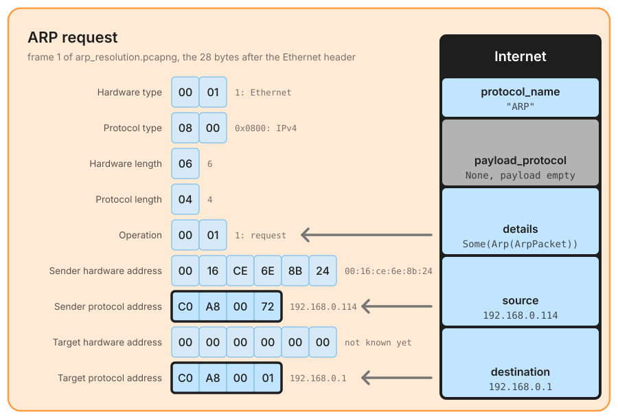
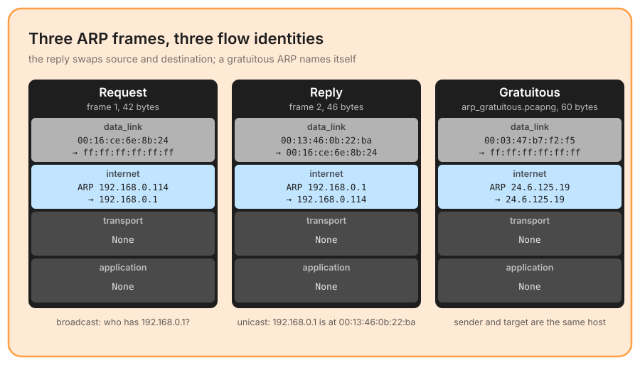

# ARP

Announced by EtherType `0x0806`, and parsed by the [internet layer](./network.md). ARP (RFC 826) maps a protocol address to a hardware address: *who has 192.168.0.1?* It has no transport, no payload, and nothing above it; what it has is two protocol addresses, and those are worth a flow identity.

## The frame

The message is 28 bytes for IPv4 over Ethernet: four bytes that describe the address formats (hardware type 1 for Ethernet, protocol type `0x0800` for IPv4, then the two address lengths, 6 and 4), the operation (1 request, 2 reply), and two pairs of addresses, sender then target. In a request the target hardware address is the question: it is sent as zeros.

`ArpPacket` keeps every field as it is on the wire: `hardware_type`, `protocol_type`, `hardware_len`, `protocol_len`, `operation`, the two hardware addresses as `[u8; 6]` and the two protocol addresses as `IpAddr`. It is reached through `details` (`InternetDetails::Arp`).

## What the internet layer keeps

ARP gets the same `Internet` struct as IPv4 and IPv6, so an ARP frame takes part in a flow table like any other packet:

- `source` and `destination` are the **sender and target protocol addresses**, classified by `IpType` like any IP address (`192.168.0.114` is `Private`; the `0.0.0.0` of an ARP probe is `Unknown`);
- `protocol_name` is `"ARP"`;
- `payload_protocol` is `None` and `payload` is empty: nothing is parsed above, `transport` and `application` stay `None`;
- `details` holds the `ArpPacket`, with the hardware addresses the flow identity does not carry.

The three frames come from the captures under `pcaps_exemple/protocols/arp/` (Chris Sanders' public set). The reply is the request with source and destination swapped, as for any conversation; the data link layer tells the broadcast from the unicast answer. A **gratuitous ARP** names itself: sender and target protocol addresses are the same host, announcing its own address.

The parser keeps no cache and takes no view on what a frame means: a reply nobody asked for, or two hardware addresses answering for the same protocol address, are things a consumer sees by keying a table on `(source, details.sender_hardware_addr)`. In `arppoison.pcapng`, that table shows one hardware address, `00:25:b3:bf:91:ee`, claiming both `172.16.0.1` and `172.16.0.105`.

## Validations

✅ **Minimum length** – at least **28 bytes**, otherwise `ArpError::InvalidLength`.  
✅ **Hardware type** – **1**, Ethernet, otherwise `UnsupportedHardwareType`.  
✅ **Protocol type** – IPv4 (`0x0800`) or IPv6 (`0x86DD`), otherwise `UnsupportedProtocolType`.  
✅ **Hardware length** – **6**, otherwise `InvalidHardwareLength`.  
✅ **Dynamic length** – the buffer holds `8 + 2 × hardware length + 2 × protocol length` bytes, otherwise `InvalidLength` with that expected size.  
✅ **Protocol length** – **4** for IPv4, **16** for IPv6, otherwise `InvalidProtocolLength`.  
✅ **Operation** – **1** (request) or **2** (reply), otherwise `UnsupportedOperation`.  

Bytes past the message are ignored: the reply above is 46 bytes on the wire, four more than the request, and the gratuitous frame is padded to the 60-byte Ethernet minimum; neither changes the result. Since the EtherType said ARP, a failed check is reported in `corrupted` (`layer: Internet`, `error: "ARP error: Invalid ARP packet length: expected at least 28 bytes, got 27 bytes"`), not dropped.

## What is left out

- **Only requests and replies.** Inverse ARP (operations 8 and 9) travels under the same EtherType and comes out `corrupted` with `Unsupported ARP operation: 8`. RARP never reaches this parser: it has its own EtherType, `0x8035`.
- **Only Ethernet addresses.** Hardware type 1 and 6-byte hardware addresses; a frame for another link type is `corrupted`.
- **IPv6 over ARP is accepted** (protocol type `0x86DD`, 16-byte addresses), although IPv6 resolves addresses with Neighbor Discovery, decoded in the [ICMPv6 page](./icmp.md).
- **No cache, no detection**: see above.
