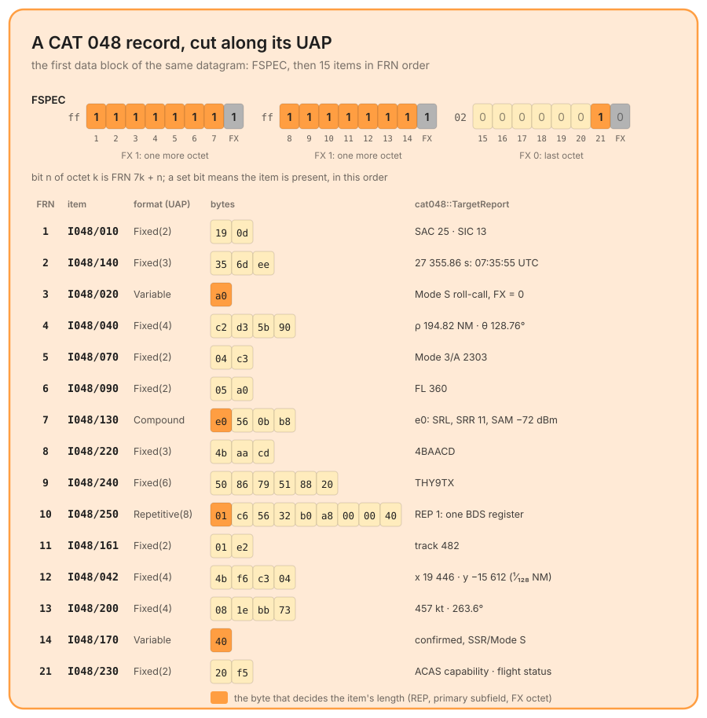

# ASTERIX

ASTERIX (All Purpose STructured EUROCONTROL SuRveillance Information EXchange, EUROCONTROL-SPEC-0149) is the exchange format of air traffic surveillance data: radar plots and tracks, ADS-B reports, service messages between a radar and its users. It travels in UDP datagrams, usually multicast, and it is the first protocol of the crate with **neither a magic nor a port**: no IANA assignment (Wireshark proposes 8600, the maintainer's radars use 8611 and 8612, Croatia Control's 21111 to 22135), and nothing in the first bytes names the protocol. What it has is structure, and the crate recognizes it by that alone: a [blind probe](./application.md#three-detection-routes) of the dispatch table, `rule("ASTERIX", Guard::Udp, ProbeId::Asterix)`, placed before DNS, whose datagram form is less constrained.

Three categories are decoded: **CAT 048**, monoradar target reports (plots and tracks), **CAT 034**, the service messages of the same radar (north marker, sector crossing), and **CAT 021**, ADS-B reports in their 2.x editions. Module: `packet_parser::parse::application::protocols::asterix`.

## The datagram: data blocks


A datagram is one or more **data blocks** back to back. Each starts with one byte of category (`CAT`) and two bytes of length (`LEN`, header included), then holds one or more records. `AsterixPacket::try_from` reads blocks until the payload is consumed, and the lengths must add up to the payload exactly: a block shorter than 5 bytes or longer than what is left is `AsterixError::InvalidBlockLength`, fewer than 3 bytes left after a block is `Truncated`, and a category without a UAP is `UnsupportedCategory`. The datagram drawn above is frame 3 of `cat_034_048.pcap`: a CAT 048 plot followed by the CAT 034 sector-crossing message of the same radar (SAC 25, SIC 13), 55 + 11 = 66 bytes.

```rust
#[non_exhaustive]
pub struct AsterixPacket<'a> {
    pub blocks: Vec<AsterixDataBlock<'a>>,
}

#[non_exhaustive]
pub struct AsterixDataBlock<'a> {
    pub category: u8,
    pub length: u16,
    pub records: Vec<AsterixRecord<'a>>,
}
```

## The record: FSPEC, then the UAP



A record starts with its **FSPEC**, a run of octets in which each of the seven high bits announces one data item and the low bit, **FX**, announces one more FSPEC octet. Bit *n* of octet *k* is Field Reference Number 7*k* + *n*. Which item an FRN names, and in what format, is fixed by the **UAP** of the category (`uap.rs`): 28 FRNs for CAT 048, so at most 4 FSPEC octets, 14 for CAT 034, 49 for CAT 021, where FRNs 43 to 47 are undefined and set bits there are `UnknownFrn`. An FSPEC longer than the UAP allows, or one whose FX never drops, is `FspecOverflow`; an FSPEC that sets no bit at all is `EmptyRecord`.

The items are then cut in FRN order, each one a zero-copy slice:

```rust
#[non_exhaustive]
pub struct AsterixRecord<'a> {
    pub category: u8,
    pub fspec: &'a [u8],
    pub items: Vec<AsterixItem<'a>>,
}

#[non_exhaustive]
pub struct AsterixItem<'a> {
    pub frn: u8,
    pub id: &'static str,   // "I048/240"
    pub data: &'a [u8],
}
```

`record.item("I048/240")` returns the bytes of an item, `record.has(..)` says whether it is there. A record ends where its last item ends, and the next record starts right there, until the block is consumed: the record of the drawing is the whole 52-byte body of its block.

## Five item formats


The UAP names the format, and the format says where the item ends. The crate cuts along these five rules and nothing else: at this level an item is bytes, not a value.

- **Fixed(n)**: *n* bytes, from the UAP.
- **Variable**: octets chained by their FX bit, like the FSPEC. `I048/020` is one octet in the drawing (`a0`, FX 0) and two in the short datagram of the anonymized capture (`01 60`).
- **Repetitive(n)**: a one-byte count `REP`, then `REP × n` bytes. `I048/250` carries the Mode S BDS registers, 8 bytes each.
- **Compound**: a primary subfield, itself FX-chained, whose bits say which subfields follow; each subfield is fixed, variable or repetitive, and a bit set on a spare subfield, or beyond the list, is `UnknownSubfield`. `I048/130` here announces its first three subfields, one byte each; in the anonymized capture the same item is a single `00`: a compound with no subfield at all.
- **Explicit**: the first byte is the length, itself included; zero is `InvalidExplicitLength`. The `RE` and `SP` items of every category are explicit, which is how a record can carry data the UAP does not describe.

An item that needs more bytes than its block holds is `TruncatedItem`, with the item's id in the error.

## Typed values, on demand

The cut is the contract; the decoding is separate, per category, and never allocates for what it does not read. `cat048::TargetReport::from_record`, `cat034::ServiceMessage::from_record` and `cat021::TargetReport::from_record` each turn the usual items of a record into typed fields, every one an `Option`, with unit conversions on the types of `fields`: `TimeOfDay::seconds()` (LSB 1/128 s), `PolarPosition::range_nm()` and `azimuth_deg()`, `FlightLevel::flight_level()` (LSB 1/4 FL), `Mode3ACode` displayed in octal, `AircraftAddress` in hexadecimal, `AircraftIdentification` from its 6-bit ICAO characters (a code outside the alphabet is rendered `?`). On the record above:

```rust
use packet_parser::parse::application::protocols::asterix::{AsterixPacket, cat048};

let packet = AsterixPacket::try_from(transport.payload.unwrap())?;
let record = &packet.blocks[0].records[0];
let report = cat048::TargetReport::from_record(record).expect("a CAT 048 record");
println!("{} ({}) at {:.2} NM / {:.2}°, FL {}, {:.0} kt heading {:.1}°",
    report.aircraft_identification.unwrap().trimmed(),
    report.aircraft_address.unwrap(),
    report.polar_position.unwrap().range_nm(),
    report.polar_position.unwrap().azimuth_deg(),
    report.flight_level.unwrap().flight_level(),
    report.polar_velocity.unwrap().ground_speed_kt(),
    report.polar_velocity.unwrap().heading_deg());
```

```text
THY9TX (4BAACD) at 194.82 NM / 128.76°, FL 360, 457 kt heading 263.6°
```

The CAT 034 block of the same datagram gives a `ServiceMessage { message_type: SectorCrossing, sector_number: 96, .. }`, and `sector_azimuth_deg()` says 135°. What a typed decoder does not read stays reachable through `record.item(..)`: the BDS register of `I048/250`, the subfields of `I048/130`, the `RE` of a CAT 021 report.

## The probe: all or nothing

`ProbeId::Asterix` is `AsterixPacket::try_from(payload).is_ok()`: the label is given only when the whole datagram cuts cleanly, every block of a decoded category, every record filling its block to the last byte. `CAT + LEN` alone would match far too many datagrams; the structure of a block of an unknown category cannot be checked, so one such block refuses the whole datagram rather than labelling half of it. The drawing of the datagram shows three refusals, each checked with the crate: a block of CAT 062 (`UnsupportedCategory`), a length one byte too long (the extra byte opens a record whose first item is truncated), one trailing byte (`Truncated`, 3 bytes needed). Zero padding inside a block fails the same way: a record of `00` is `EmptyRecord`. A refused datagram goes on to the next rules of the table and usually comes out `"Unknown"`.

The probe runs on the first `PROBE_CAP` bytes of the payload, 18 KiB: a datagram larger than that is cut before the probe and cannot tile, so it is not labelled. Surveillance datagrams are far smaller.

## Verified against tshark, record by record

`tests/asterix_golden.rs` replays the corpus of `pcaps_exemple/protocols/asterix/` (see its `SOURCE.md`): the maintainer's anonymized CAT 048 capture (203 datagrams on ports 8611 and 8612), Croatia Control's CAT 034/048 sample (100 datagrams, 20 of them with two blocks, up to three records per block) and its raw CAT 021 stream. For every record of every frame, the exact sequence of items is compared with an oracle produced by tshark 4.6.6 (`tests/data/asterix_tshark_oracle.tsv`), and the typed values with its `-V` output. On the reference corpus the probe labels exactly the 303 frames `tshark -Y asterix` sees, and no other. The fuzz target `parse_asterix` asserts, on whatever it decodes, that the block lengths add up to the input, that every item is non-empty and lies inside the buffer, and that the FSPECs and items of a block cover its length exactly.

## What is left out

- **Other categories.** CAT 001, 002, 008, 062, 063 and 065 have no UAP in the crate ([#119](https://github.com/Akmot9/Packet-parser/issues/119)): the 30 047 datagrams of `wireshark_8579_radardata.pcap` that carry one of them come out `"Unknown"`, while its 11 881 datagrams of pure CAT 034/048 are labelled.
- **CAT 021 editions 0.2x**, whose UAP is entirely different from 2.x: nothing in the bytes tells the editions apart, and the crate decodes 2.x.
- **Item contents** beyond the typed subset: `RE` and `SP` stay opaque, BDS registers are raw bytes, the subfields of a compound are cut but not interpreted.
- `AsterixError::BlockNotConsumed` is declared but never returned: a block of at least 5 bytes always yields a record or a more precise error.
