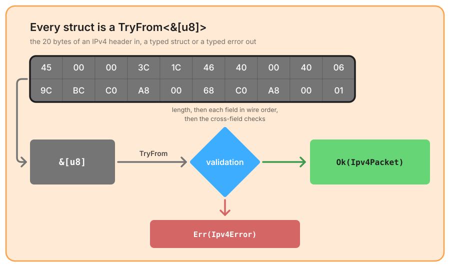

# Data validation procedure



When we receive a packet, we use `TryFrom` to apply several validation steps to it.  
If the validations succeed, the function returns a structured representation of the packet or a part of it.  
If the validations fail, it returns a custom error, implemented using the [thiserror crate](https://crates.io/crates/thiserror).

The top-level API returns `ParseError`; each layer and each protocol has its own error type (`DataLinkError`, `Ipv4Error`, `TcpError`, `NtpPacketParseError`...).

## Every struct is a `TryFrom<&[u8]>`

This is the one rule of the crate. `DataLink`, `Ipv4Packet`, `TcpPacket`, `DnsPacket`, `TlsPacket`... all of them are built the same way:

```rust
impl<'a> TryFrom<&'a [u8]> for Ipv4Packet<'a> {
    type Error = Ipv4Error;

    fn try_from(data: &'a [u8]) -> Result<Self, Self::Error> {
        validate_ipv4_min_length(data)?;

        let version_ihl = data[0];
        validate_ipv4_version(version_ihl >> 4)?;

        let header_len = ((version_ihl & 0x0F) as usize) * 4;
        validate_ipv4_header_length(header_len)?;
        validate_ipv4_header_available(data.len(), header_len)?;

        let total_length = u16::from_be_bytes([data[2], data[3]]);
        validate_ipv4_total_length(total_length, header_len, data.len())?;

        // ... every remaining field is read with from_be_bytes ...

        Ok(Ipv4Packet { /* ... */, payload: &data[header_len..total_length as usize] })
    }
}
```

The `TryFrom` is a **linear sequence**, in wire order:

1. a pre-check on the length, so that every index below is proven in-bounds;
2. one check per constrained field, chained with `?`: check the bytes of the field, place the value if it is valid, move on to the next field;
3. cross-field validations between values already extracted;
4. build the struct with the validated values, and split header from payload.

As soon as a check fails, `?` returns the typed error: the bytes are not this protocol.

## Where the checks live

The parser file only *chains* the calls. The checks themselves live in a separate, crate-internal module, one file per protocol:

```text
src/
  parse/     the TryFrom impls and the structs      (public)
  checks/    validate_* and extract_* functions       (crate-internal)
  errors/    one thiserror enum per protocol          (public)
```

Two forms of functions:

- `extract_*`: verifies the bytes of **one field** and returns the typed value, ready to be placed in the struct (`extract_stratum`, `extract_reference_id` on the NTP side);
- `validate_*`: returns `Result<(), Error>` for controls that produce no value: length pre-check, cross-field coherence (`validate_ipv4_total_length`, `validate_datetime_ordering`).

A field without any constraint (a raw counter, a free identifier) is read directly with `from_be_bytes` in the parser.

## Typed errors

Errors carry the values that failed, never a bare string, so a consumer can match on them:

```rust
#[derive(Error, Debug)]
#[non_exhaustive]
pub enum TcpError {
    #[error("Packet too short to be a valid TCP header")]
    PacketTooShort,
    #[error("Invalid data offset: {0}")]
    InvalidDataOffset(u8),
    #[error("Invalid TCP flags {flags:#04x}: SYN and FIN are both set")]
    InvalidFlags { flags: u8 },
    #[error("TCP reserved bits are set: {bits:#05b}")]
    ReservedBitsSet { bits: u8 },
}
```

Errors nest with `#[from]`: `Ipv4Error` converts into `InternetError`, which converts into `ParseError`. Every error enum is `#[non_exhaustive]`, so a new variant can be added in a minor version; a `match` on them needs a `_` arm.

## Structural corruption vs. semantic anomaly

Not every failed check means the same thing:

- **structural**: the bytes cannot be read as this protocol (truncated header, impossible length). The `TryFrom` returns `Err`, and in the pipeline the layer becomes `None` with `corrupted: Some(..)`;
- **semantic**: the header reads fine but says something no conforming stack emits (TCP SYN+FIN, reserved bits set). The `TryFrom` returns `Ok`; the anomaly is exposed by `TcpPacket::anomaly()`, and the pipeline **keeps** the layer while reporting it in `corrupted`. This is a classic scan signature: the ports must stay available for correlation.

## Fail-closed below, fail-soft above

The two error paths of `PacketFlow` are asymmetric on purpose:

- the **link layer is fail-closed**: an unsupported LINKTYPE or a truncated link header returns `Err(ParseError)`. Without a valid link layer there is nothing trustworthy to build on;
- **everything above is fail-soft**: an unsupported protocol leaves the layer `None`, a corrupt one is reported in `corrupted`. Real-world traffic is full of protocols the crate does not decode, and a flow matrix must not lose the L2/L3 information because of an odd L4.

## No panic on hostile bytes

A parser of hostile bytes must never bring its host down. What the crate does about it, precisely:

- **Lints.** `lib.rs` enables `clippy::unwrap_used`, `clippy::expect_used` and `clippy::panic` as *warnings* outside of tests, and the CI runs clippy with `-D warnings`, which makes them blocking. The rare justified sites carry a motivated `#[expect]`. Test code is free to `unwrap`.
- **The indexing idiom.** `data[0]` after `validate_ipv4_min_length(data)` is the pattern everywhere: index after an explicit length check. The lints `indexing_slicing` and `arithmetic_side_effects` are deliberately *not* enabled: with more than a thousand such accesses, they would flag every one of them.
- **Fuzzing.** The absence of panic on these accesses is exercised by the fuzz targets under `fuzz/`, the 24 `[[bin]]` entries of `fuzz/Cargo.toml`. Each one feeds hostile bytes to an entry point and, beyond the absence of panic, most check what an accepted input must satisfy:
  - `parse_packetflow`: `PacketFlow::try_from`, then `parse_with` with one Decode As port chosen by the first three bytes among the 27 `DecodeAsProtocol`s; nothing else is checked, the policies are `policy_dispatch`'s;
  - `parse_dns`: `DnsPacket::try_from`, name compression included: hostile pointers must create neither a loop nor a panic;
  - `parse_application`: `Application::try_from`, the blind cascade without ports: every probe must reject hostile bytes cleanly;
  - `parse_linktype`: `parse` with a LINKTYPE chosen by the first byte among all those `is_supported` announces, plus `u32::MAX` and the byte itself, then `to_owned_flow` and `flatten`;
  - `parse_quic`: `QuicPacket::try_from`, the Long Header: varints, Connection IDs and the Length field;
  - `parse_s7comm`: `S7CommPacket::try_from`: an accepted packet satisfies the TPKT + COTP-DT + S7 invariants, lengths included;
  - `parse_cotp`: `CotpHeader::from_bytes` and `CotpHeader::try_from`: the two entry points agree, and LI, TPDU type and exposed fields are consistent;
  - `parse_giop`: `find_giop_message` and `giop_messages`: CDR cursor, IORs and IIOP profiles, resynchronization; no message covers more bytes than the buffer;
  - `parse_asterix`: `AsterixPacket::try_from` over the eleven categories: the data blocks tile the input, every item points into it, and the typed decoders accept every record;
  - `parse_ptp`: `PtpPacket::try_from` and `try_from_udp`: message, TLVs and trailing bytes tile the input, and the UDP form accepts a subset of the layer 2 one;
  - `parse_profinet`: `validate_frame` and `ProfinetPacket::try_from`: DCP is decoded only for DCP Frame IDs, and its blocks and NameOfStation point into the buffer;
  - `parse_rtps`: `RtpsPacket::try_from`: the submessages tile the message and borrow from the input;
  - `parse_stanag5066`: `SisPdu::try_from` on chained S_PDUs: `consumed` stays within the input, and a complete S_PDU is followed by the start of another one or by nothing;
  - `parse_dis`: `DisPacket::try_from` and `try_from_lenient`: the PDUs tile the input, and the strict reading accepts a subset of the lenient one;
  - `parse_ipsec`: `IkePacket::try_from`, `IkePacket::from_udp`, `UdpEncapsulation::classify` and `EspPacket::try_from`: the payloads tile the message, and the demultiplexing of UDP 4500 is a partition;
  - `parse_dnp3`: `Dnp3Packet::try_from`: the link frames tile the input, and any single-byte change of a real seed is rejected, the CRCs being what makes the blind probe safe;
  - `parse_radius`: `RadiusPacket::try_from`: the attributes tile the packet, whose declared length is the input's;
  - `parse_rdp`: `RdpPacket::try_from`: the TPKTs tile the segment, the last one possibly cut;
  - `parse_iec104`: `Iec104Packet::try_from`: the APDUs tile the segment, the last one possibly cut, and an ASDU in sequence numbers its objects one after the other;
  - `parse_bacnet`: `BacnetPacket::try_from`: the BVLC length is the input's, and every borrow points into it;
  - `parse_goose`: `GoosePacket::try_from`: the length is the input's, and the number of allData elements is bounded by it;
  - `parse_lldp`: `LldpPacket::try_from`: the TLVs and the padding tile the input, and the blind probe of `Internet::try_from` never accepts an LLDPDU the decoder refuses;
  - `parse_wireguard`: `WireGuardPacket::try_from`: the size is the one of the type, a keepalive is exactly 32 bytes, and what the blind cascade labels WireGuard has null reserved bytes;
  - `policy_dispatch`: the oracles of the dispatch policy, moved out of `parse_packetflow` by [#108](https://github.com/Akmot9/Packet-parser/issues/108): FTP, SMTP and NNTP off their ports, S7Comm, COTP and Decode As, through `PacketFlow::try_from` and `parse_with`; its text oracle is shared with `tests/fuzz_policy_parity.rs`, which compares it with the dispatch table on every pull request.

  Most protocol targets also mutate seeds built from real frames of the corpus, named in their comments, so that hostile bytes reach the deep paths from the first run. The nightly workflow, `.github/workflows/fuzz.yml`, draws its matrix from these `[[bin]]` entries, so that a new target runs the very night it is added; it keeps each target's corpus from one night to the next, and a failed night opens or completes a `fuzz-failure` issue. On every pull request, the CI checks that each file of `fuzz/fuzz_targets/` has its `[[bin]]`, builds the targets and runs each one once (`-runs=1`), which also runs the fixed oracles of `policy_dispatch`.

None of this is a proof. Lints catch the explicit panics, not an out-of-bounds index; fuzzing finds panics, it does not demonstrate their absence. What the crate can claim is that every parser follows the same length-checked discipline, that the tooling refuses the obvious deviations, and that the fuzzers have not found a panic on the published versions. The same honesty applies to the other properties described in this book: `TryFrom` and `corrupted` describe how the *supported* layers behave; a protocol the crate does not decode is simply `None`, and zero-copy holds for the L2/L3/L4 structs and most application parsers — a few (DNS, HTTP, SNMP, GIOP service contexts) allocate `Vec`s for lists whose length the packet dictates, always bounded first.

Now let's go layer by layer.
