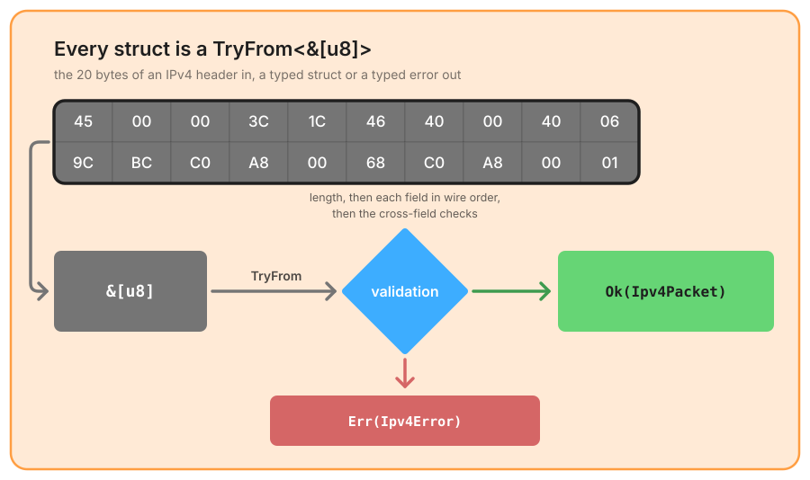

# Data validation procedure



Every struct of the crate is built by a `TryFrom` that applies its validation steps to the bytes. When they all pass, it returns the typed structure. When one fails, it returns a typed error, defined with the [thiserror crate](https://crates.io/crates/thiserror).

The top-level API returns `ParseError`; each layer and each protocol has its own error type (`DataLinkError`, `Ipv4Error`, `TcpError`, `NtpPacketParseError`...).

## Every struct is a `TryFrom<&[u8]>`

This is the one rule of the crate. `DataLink`, `Ipv4Packet`, `TcpPacket`, `DnsPacket`, `TlsPacket`... all of them are built the same way:

```rust
impl<'a> TryFrom<&'a [u8]> for Ipv4Packet<'a> {
    type Error = Ipv4Error;

    fn try_from(data: &'a [u8]) -> Result<Self, Self::Error> {
        validate_ipv4_min_length(data)?;

        let version_ihl = data[0];
        validate_ipv4_version(version_ihl >> 4)?;

        let header_len = ((version_ihl & 0x0F) as usize) * 4;
        validate_ipv4_header_length(header_len)?;
        validate_ipv4_header_available(data.len(), header_len)?;

        let total_length = u16::from_be_bytes([data[2], data[3]]);
        validate_ipv4_total_length(total_length, header_len, data.len())?;

        // ... every remaining field is read with from_be_bytes ...

        // 0 is accepted: before TCP segmentation offload, the stack leaves the
        // total length to the network card, and the payload runs to the end of the frame.
        let end = if total_length == 0 { data.len() } else { usize::from(total_length) };
        Ok(Ipv4Packet { /* ... */, payload: &data[header_len..end] })
    }
}
```

The `TryFrom` is a **linear sequence**, in wire order:

1. a pre-check on the length, so that every index below is proven in-bounds;
2. one check per constrained field, chained with `?`: check the bytes of the field, place the value if it is valid, move on to the next field;
3. cross-field validations between values already extracted;
4. build the struct with the validated values, and split header from payload.

As soon as a check fails, `?` returns the typed error: the bytes are not this protocol.

## Where the checks live

The parser file only *chains* the calls. The checks themselves live in a separate, crate-internal module, one file per protocol:

```text
src/
  parse/     the TryFrom impls and the structs      (public)
  checks/    validate_* and extract_* functions       (crate-internal)
  errors/    one thiserror enum per protocol          (public)
```

Two forms of functions:

- `extract_*`: verifies the bytes of **one field** and returns the typed value, ready to be placed in the struct (`extract_stratum`, `extract_reference_id` on the NTP side);
- `validate_*`: returns `Result<(), Error>` for controls that produce no value: length pre-check, cross-field coherence (`validate_ipv4_total_length`, `validate_datetime_ordering`).

A field without any constraint (a raw counter, a free identifier) is read directly with `from_be_bytes` in the parser.

## Typed errors

Errors carry the values that failed, never a bare string, so a consumer can match on them:

```rust
#[derive(Error, Debug)]
#[non_exhaustive]
pub enum TcpError {
    #[error("Packet too short to be a valid TCP header")]
    PacketTooShort,
    #[error("Invalid data offset: {0}")]
    InvalidDataOffset(u8),
    #[error("Invalid TCP flags {flags:#04x}: SYN and FIN are both set")]
    InvalidFlags { flags: u8 },
    #[error("TCP reserved bits are set: {bits:#05b}")]
    ReservedBitsSet { bits: u8 },
}
```

Errors nest with `#[from]`: `Ipv4Error` converts into `InternetError`, which converts into `ParseError`. Every error enum is `#[non_exhaustive]`, so a new variant can be added in a minor version; a `match` on them needs a `_` arm.

## Structural corruption vs. semantic anomaly

Not every failed check means the same thing:

- **structural**: the bytes cannot be read as this protocol (truncated header, impossible length). The `TryFrom` returns `Err`, and in the pipeline the layer becomes `None` with `corrupted: Some(..)`;
- **semantic**: the header reads fine but says something no conforming stack emits (TCP SYN+FIN, reserved bits set). The `TryFrom` returns `Ok`; the anomaly is exposed by `TcpPacket::anomaly()`, and the pipeline **keeps** the layer while reporting it in `corrupted`. This is a classic scan signature: the ports must stay available for correlation.

## Fail-closed below, fail-soft above

The two error paths of `PacketFlow` are asymmetric on purpose:

- the **link layer is fail-closed**: an unsupported LINKTYPE or a truncated link header returns `Err(ParseError)`. Without a valid link layer there is nothing trustworthy to build on;
- **everything above is fail-soft**: an unsupported protocol leaves the layer `None`, a corrupt one is reported in `corrupted`. Real-world traffic is full of protocols the crate does not decode, and a flow matrix must not lose the L2/L3 information because of an odd L4.

## No panic on hostile bytes

A parser of hostile bytes must never bring its host down. What the crate does about it, precisely:

- **Lints.** `lib.rs` enables `clippy::unwrap_used`, `clippy::expect_used` and `clippy::panic` as *warnings* outside of tests, and the CI runs clippy with `-D warnings`, which makes them blocking. The rare justified sites carry a motivated `#[expect]`. Test code is free to `unwrap`.
- **Truncating casts.** 12.1.0 adds `clippy::cast_possible_truncation` to these lints ([#273](https://github.com/Akmot9/Packet-parser/issues/273)): a number read from the wire is no longer narrowed with `as`, it goes through `From` or `try_from`. The lint found a defect in QUIC. Two lengths read from a varint, Token Length and Length, were cut from `u64` to `usize`. On a 32-bit target a value of 2<sup>32</sup> or more lost its high bits, and the decoder read fewer bytes than the packet announced instead of refusing it. Both now saturate, and the bounds check refuses them (`Truncated`, `PayloadTooShort`); nothing changes on 64 bits. Of the 32 other casts found, five keep a motivated `#[expect]`: the IPv4 pseudo-header, two ASTERIX FRNs, the DNP3 CRC table and the nanoseconds of GOOSE.
- **The indexing idiom.** `data[0]` after `validate_ipv4_min_length(data)` is the pattern everywhere: index after an explicit length check. The lints `indexing_slicing` and `arithmetic_side_effects` are deliberately *not* enabled: with more than a thousand such accesses, they would flag every one of them.
- **Fuzzing.** The absence of panic on these accesses is exercised by the fuzz targets under `fuzz/`, the 42 `[[bin]]` entries of `fuzz/Cargo.toml`. Each one feeds hostile bytes to an entry point and, beyond the absence of panic, most check what an accepted input must satisfy:
  - `parse_packetflow`: `PacketFlow::try_from`, then `parse_with` with one Decode As port: the first byte chooses the protocol in `DecodeAsProtocol::ALL`, the next two are the port; nothing else is checked, the policies are `policy_dispatch`'s;
  - `parse_dns`: `DnsPacket::try_from`, name compression included: hostile pointers must create neither a loop nor a panic;
  - `parse_application`: `classify_payload`. Five leading bytes choose the transport and the two ports, the rest is the payload, so every probe of the table is reached, port rules included, and must reject hostile bytes cleanly; one input in two is also classified with no port. On TCP or UDP with its ports, the label must be the one `parse` gives the Ethernet/IPv4 frame built around the same payload;
  - `parse_linktype`: `parse` with a LINKTYPE chosen by the first byte among all those `is_supported` announces, plus `u32::MAX` and the byte itself, then `to_owned_flow` and `flatten`;
  - `parse_quic`: `QuicPacket::try_from`, the Long Header: varints, Connection IDs and the Length field; since 13.1.0 also the Version Negotiation, version 0 then versions of 4 bytes to the end of the input;
  - `parse_s7comm`: `S7CommPacket::try_from`: an accepted packet satisfies the TPKT + COTP-DT + S7 invariants, lengths included;
  - `parse_cotp`: `CotpHeader::from_bytes` and `CotpHeader::try_from`: the two entry points agree, and LI, TPDU type and exposed fields are consistent;
  - `parse_giop`: `find_giop_message` and `giop_messages`: CDR cursor, IORs and IIOP profiles, resynchronization; no message covers more bytes than the buffer;
  - `parse_asterix`: `AsterixPacket::try_from` over the eleven categories: the data blocks tile the input, every item points into it, and every typed decoder is run on every record;
  - `parse_ptp`: `PtpPacket::try_from` and `try_from_udp`: message, TLVs and trailing bytes tile the input, and the UDP form accepts a subset of the layer 2 one;
  - `parse_profinet`: `validate_frame` and `ProfinetPacket::try_from`: DCP is decoded only for DCP Frame IDs, and its blocks and NameOfStation point into the buffer;
  - `parse_rtps`: `RtpsPacket::try_from`: the submessages tile the message and borrow from the input; since 13.0.0 it also calls `inline_qos()`, `serialized_payload()` and `discovery()` on every submessage: each decoded ParameterList, its values and the serialized data point into the body of the submessage, the parameters tile their list, and every typed accessor reads without a panic, with three DDS frames of the corpus added to its mutation seeds;
  - `parse_stanag5066`: `SisPdu::try_from` on chained S_PDUs: `consumed` stays within the input, the U_PDU borrows from it, and a cut S_PDU is the last one, running to the end of the input;
  - `parse_dis`: `DisPacket::try_from` and `try_from_lenient`: the PDUs, then the trailing bytes of the lenient reading, tile the input, and the strict reading accepts exactly the lenient readings that leave no trailing bytes;
  - `parse_ipsec`: `IkePacket::try_from`, `IkePacket::from_udp`, `UdpEncapsulation::classify` and `EspPacket::try_from`: the payloads tile the message, and the demultiplexing of UDP 4500 is a partition;
  - `parse_dnp3`: `Dnp3Packet::try_from`: the link frames tile the input, and any single-byte change of a real seed is rejected, the CRCs being what makes the blind probe safe; since 11.7.0 it also mutates the user data alone and recomputes the CRCs, so that its mutations reach the transport and application layers and the object headers;
  - `parse_radius`: `RadiusPacket::try_from`: the attributes tile the packet, whose declared length is the input's;
  - `parse_rdp`: `RdpPacket::try_from`: the TPKTs tile the segment, the last one possibly cut;
  - `parse_iec104`: `Iec104Packet::try_from`: the APDUs tile the segment, the last one possibly cut, and an ASDU in sequence numbers its objects one after the other;
  - `parse_bacnet`: `BacnetPacket::try_from`: the BVLC length is the input's, and every borrow points into it;
  - `parse_goose`: `GoosePacket::try_from`: the length is the input's, and the number of allData elements is bounded by it;
  - `parse_lldp`: `LldpPacket::try_from`: the TLVs and the padding tile the input, and the blind probe of `Internet::try_from` never accepts an LLDPDU the decoder refuses;
  - `parse_valmet_dna`: `ValmetDnaPacket::try_from` and `TimeBeacon::try_from`: the declared length is the input's minus two, the tag and the body borrow from the input, the clocks are within their ranges, and `classify_payload`, on UDP and with no port, says `"Valmet DNA"` exactly when the message family is known;
  - `parse_wireguard`: `WireGuardPacket::try_from`: the size is the one of the type, a keepalive is exactly 32 bytes, and what the blind cascade labels WireGuard has null reserved bytes;
  - `policy_dispatch`: the oracles of the dispatch policy, moved out of `parse_packetflow` by [#108](https://github.com/Akmot9/Packet-parser/issues/108): FTP, SMTP and NNTP off their ports, S7Comm, COTP and Decode As, through `PacketFlow::try_from` and `parse_with`; its text oracle is shared with `tests/fuzz_policy_parity.rs`, which compares it with the dispatch table on every pull request.

  12.1.0 adds fourteen targets, one per application decoder ([#272](https://github.com/Akmot9/Packet-parser/issues/272)). Nineteen decoders were reached only through the dispatch, by `parse_application`, `parse_packetflow` and `policy_dispatch`; measured on them, line coverage went from 77.9 % to 94.3 %. Each target also calls what the dispatch never calls: iterators, on-demand bodies, `Display`.

  - `parse_dhcpv6`: `Dhcpv6Packet::try_from`: message type and transaction ID are those of the wire, and the options are the input without its first four bytes;
  - `parse_ethernet_ip`: `EtherNetIpPacket::try_from`: the declared length is the input's, the items of the Common Packet Format tile the command data, and the iterator, `len` and `get` agree;
  - `parse_http`: `HttpRequest::try_from` and `HttpResponse::try_from`: method, URI, version and headers borrow from the input, the body is its end, the header iterator agrees with `len`, `is_empty` and `get`, and `parse_http_request` and `parse_http_response` give the verdict of `try_from`;
  - `parse_mqtt`: `MqttPacket::try_from`, 3.1.1 and 5: the variable header and the payload of the first packet add up to its Remaining Length and point into the input;
  - `parse_netbios`: `NbnsPacket::try_from` and `NbssPacket::try_from`: the NBNS counts are the lengths of its vectors, every borrow points into the input, and the NBSS payload has the declared length;
  - `parse_ntp`: `NtpPacket::try_from`: the fields are those of the wire, and the reference has the form its stratum imposes;
  - `parse_opcua`: `OpcuaPacket::try_from`: the chunks the iterator returns tile the input, only the last one may be cut or be followed by 1 to 7 bytes, the start of the next header, which must start one of the seven message types and, from the fourth byte, a chunk type (13.1.1, [#333](https://github.com/Akmot9/Packet-parser/issues/333)), every borrow points into the input, and `len` and `get` agree with the iterator;
  - `parse_openvpn`: `OpenVpnPacket::try_from` and `from_tcp_stream`: opcode and key_id are those of the first byte, the payload is what follows the header of its opcode, and the TCP form returns the declared record, then the rest of the stream;
  - `parse_postgresql`: `PostgreSqlPacket::try_from`: the typed messages tile the input, every declared length is the one of its payload, and every borrow points into the input;
  - `parse_snmp`: `SnmpPacket::try_from`, v1, v2c and v3: the message has the form of its version, the PDU the form of its type, and every borrow points into the input;
  - `parse_srvloc`: `SrvlocPacket::try_from`, SLP v1 and v2: the declared length is the input's, every borrow points into it, and `body()` returns the form the function announces or an error. Its seeds are synthetic: the repository has no SLP capture;
  - `parse_ssdp`: `SsdpPacket::try_from`: every header value borrows from the input, and a search always carries its MAN;
  - `parse_tls`: `TlsPacket::try_from`, `looks_like_tls` and `parse_tls_records`: `looks_like_tls` gives the verdict of `try_from`, the list of records is empty exactly when the first one does not decode, and the records follow one another from the start of the input, each with the type, version and length of its header;
  - `parse_umas`: `UmasPacket::try_from` and `MBAP::try_from`: the Modbus function code is `0x5A`, session and UMAS function are the first two bytes of the PDU, the data are what follows, and the MBAP also decodes alone.

  13.x adds three targets:

  - `parse_java_rmi`: `JavaRmiPacket::try_from` on the input and on seven frames of the JDK capture altered by the input: the type is the first byte and every field the one of the wire, what follows a stream header, the arguments and the value end the input, the hostname points into it, and `is_self_identifying` holds exactly for a stream header, a Call or a Return;
  - `parse_rules`: `RuleSet::from_toml` on any text, which is accepted or refused but never panics; an accepted file then runs its rules on its own bytes. The same bytes then go, as a TCP and as a UDP payload on a few ports, through the rules of a fixed file, fields included ([#325](https://github.com/Akmot9/Packet-parser/issues/325));
  - `parse_sip`, in 13.2.0: `SipMessage::try_from` on the input and on two synthetic messages altered by it, the INVITE of RFC 3261 §24.2 and a 180 Ringing with compact headers, one of them folded: every field points into the input, a status code goes from 100 to 699, every method is in `SIP_METHODS`, the CSeq of a request names its method with a number below 2<sup>31</sup>, the body ends within the input and within Content-Length, and `headers.get` finds the Via and the Call-ID under their long names.

  The oracle of `parse_opcua` shows what the CI of a pull request cannot catch. 13.1.0 let a complete OPC UA chunk be followed by the start of the next header, but the oracle still wanted chunks that tile the whole input. The CI runs each target once (`-runs=1`), so the nightly run found it, on a mutated seed ([#333](https://github.com/Akmot9/Packet-parser/issues/333)). The failure showed a gap in the decoder too: below three bytes, the start of the next header was not checked. 13.1.1 fixed the decoder and the oracle together.

  Five more targets were written, then dropped: those of AMS, Bitcoin, DHCP, Modbus/TCP and SSH reached no line that the generic targets did not.

  Most protocol targets also mutate seeds built from real frames of the corpus, named in their comments, so that hostile bytes reach the deep paths from the first run. The nightly workflow, `.github/workflows/fuzz.yml`, draws its matrix from these `[[bin]]` entries, so that a new target runs the very night it is added; it keeps each target's corpus from one night to the next, and a failed night opens or completes a `fuzz-failure` issue. On every pull request, the CI checks that each file of `fuzz/fuzz_targets/` has its `[[bin]]`, builds the targets and runs each one once (`-runs=1`), which also runs the fixed oracles of `policy_dispatch`.

None of this is a proof. Lints catch the explicit panics, not an out-of-bounds index; fuzzing finds panics, it does not demonstrate their absence. What the crate can claim is that every parser follows the same length-checked discipline, that the tooling refuses the obvious deviations, and that the fuzzers have not found a panic on the published versions. The same honesty applies to the other properties described in this book: `TryFrom` and `corrupted` describe how the *supported* layers behave; a protocol the crate does not decode is simply `None`, and zero-copy holds for the L2/L3/L4 structs and for the bytes of most application parsers. Many of them do allocate a `Vec` for each list whose length the packet dictates (the records of DNS and ASTERIX, the messages of PostgreSQL and Modbus/TCP, the APDUs of IEC 104, the attributes of RADIUS, the TLVs of LLDP...), every pre-allocation bounded first by the bytes left; and two copy bytes: DNS, whose names are `String`s, and DNP3, whose user data are rebuilt without their CRCs.
