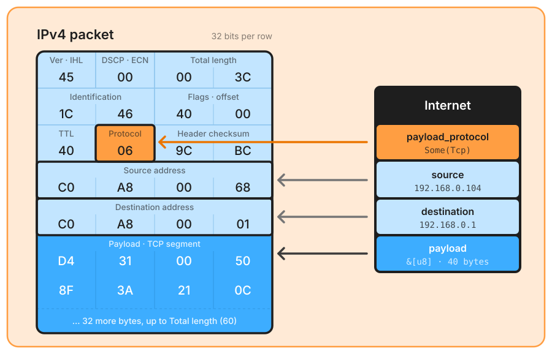

# IPv4

Announced by EtherType `0x0800` (or, inside a [PPPoE session](./pppoe.md), by the PPP protocol `0x0021`), or directly by a RAW IP capture, and parsed by the [internet layer](./network.md).



The **Protocol** byte plays the part the EtherType played one layer down: the internet layer does not parse what follows, it turns `6` into `payload_protocol: Some(Tcp)`, the announcement the [transport layer](./transport.md) dispatches on (`None` for a fragment, see [below](#fragments)). The bytes are those of a typical Linux TCP SYN, and the struct shows what `Internet::try_from_network_parts` returns for them.

✅ **Minimum length** – at least **20 bytes**, otherwise `Ipv4Error::InvalidLength`.  
✅ **Version** – the high nibble is **4**, otherwise `InvalidVersion`.  
✅ **Header length** – `IHL × 4` is between **20 and 60** bytes (IHL 5..=15), otherwise `InvalidHeaderLength`.  
✅ **Header available** – the buffer holds the whole header, options included, otherwise `InvalidLength`.  
✅ **Total length** – `total_length` is at least the header length and at most the buffer length, otherwise `InvalidTotalLength`; 0 is the one exception, see [TSO](#a-total-length-of-zero-tso). The payload is `data[header_len..total_length]`: Ethernet padding after a short IP packet is *not* handed to the transport layer.  

The upper bound has a consequence: a packet cut by the capture's snapshot length fails it and is reported in `corrupted`, although nothing was wrong on the wire. `parse` receives the captured bytes only, so a truncated capture and a lying header look the same.

Options are neither decoded nor validated: `Ipv4Packet::options` holds their raw bytes, `data[20..header_len]`, empty when IHL is 5.

The header checksum is **not** verified here: on a sender-side capture with hardware offloading it is often uncomputed, and a mandatory check would reject perfectly healthy traffic. `packet_parser::checksum::verify_ipv4_header_checksum(&[u8]) -> Option<bool>` is available when the context allows it: give it the IP packet, it returns `None` when the header itself is unreadable.

The rest of the header is reached through `details` (`InternetDetails::Ipv4`): `ttl`, `identification`, `protocol`, `header_checksum`, and typed accessors. `dscp()` returns a `Dscp` that displays its IANA name when it has one (`EF (46)`, `AF41 (34)`), `ecn()` an `Ecn` (`NotEct`, `Ect1`, `Ect0`, `Ce`, RFC 3168). Both types come from the `dscp_ecn` module that `Ipv6Packet` shares for its Traffic Class.

## A total length of zero: TSO

A host that hands TCP segmentation to its network card (TSO, LSO on Windows) gives the card one large packet, and a capture taken on that host sees it before the card cuts it, with a total length the stack has left at 0. Up to 11.5.0 such a packet failed the total length check and the internet layer was reported corrupted ([#168](https://github.com/Akmot9/Packet-parser/issues/168)). Like tshark with `ip.tso_support`, on by default, the crate now reads a total length of 0 as "up to the end of the frame":

```rust
pub fn validate_ipv4_total_length(
    total_length: u16,
    header_len: usize,
    data_len: usize,
) -> Result<(), Ipv4Error> {
    if total_length == 0 {
        return Ok(());
    }
    let total_length = total_length as usize;
    if total_length < header_len || total_length > data_len {
        return Err(Ipv4Error::InvalidTotalLength {
            expected: total_length,
            actual: data_len,
            min_header_len: header_len,
        });
    }
    Ok(())
}
```

The payload is then `data[header_len..]`, and `Ipv4Packet::total_length` keeps the wire value, 0, so a consumer can still tell such a packet apart. Any other value below the header length is still `InvalidTotalLength`. With nothing but the frame to bound it, the packet takes whatever follows it in the frame.

The golden test `tests/ipv4_tso.rs` checks two such frames: frame 275 of `pcaps_exemple/protocols/ntp/ndpi_line.pcap`, a TLS record of 3 133 bytes, and frame 47 790 of `pcaps_exemple/The-Ultimate-PCAP.pcapng`, a TLS ClientHello of 1 908 bytes; both come out `"TLS"`. The second one (*tested*):

```rust
{{#include ../examples/src/link_layer.rs:ipv4_tso}}
```

## Fragments

The crate does no IP reassembly. For a fragmented IPv4 packet (MF flag set or non-zero offset), `payload_protocol` is set to `None` so the transport layer is **not** parsed from incomplete data: a TCP header read from the second fragment of a datagram would be garbage with valid-looking ports. The first fragment is skipped too, although it does start with the L4 header: a UDP length field covers the whole datagram, so UDP's exact-length check would report a healthy fragment as corrupt, and the application probes would see a cut payload. The cost is that a fragmented packet has no `transport` and no ports. `Ipv4Packet::is_fragmented()`, `more_fragments()`, `fragment_offset()` and `is_non_initial_fragment()` expose the flags through `details`.
