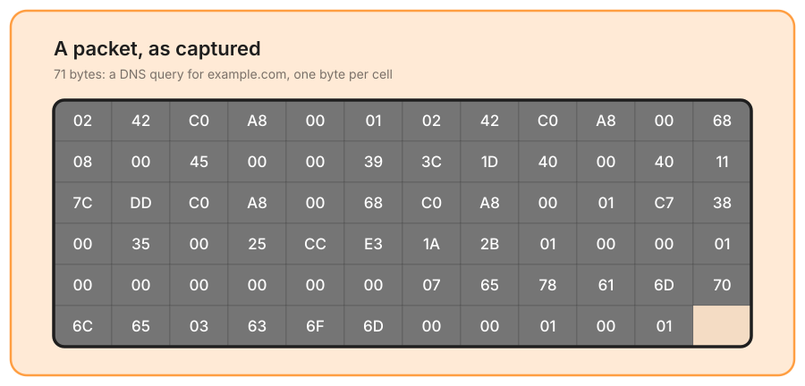
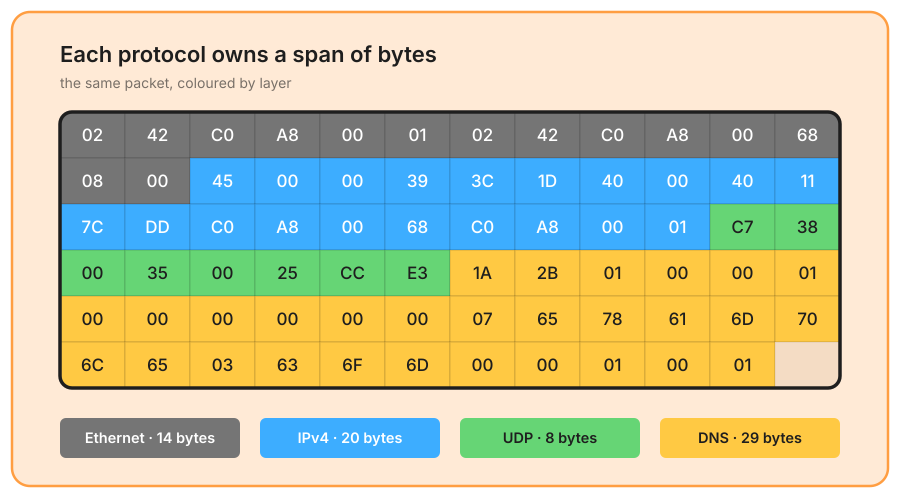
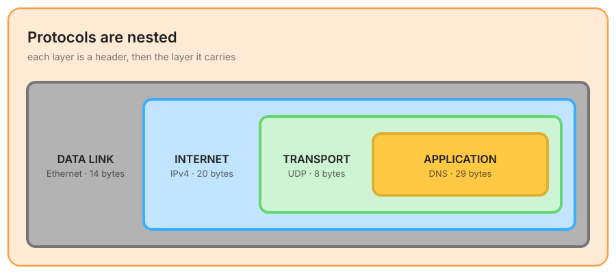
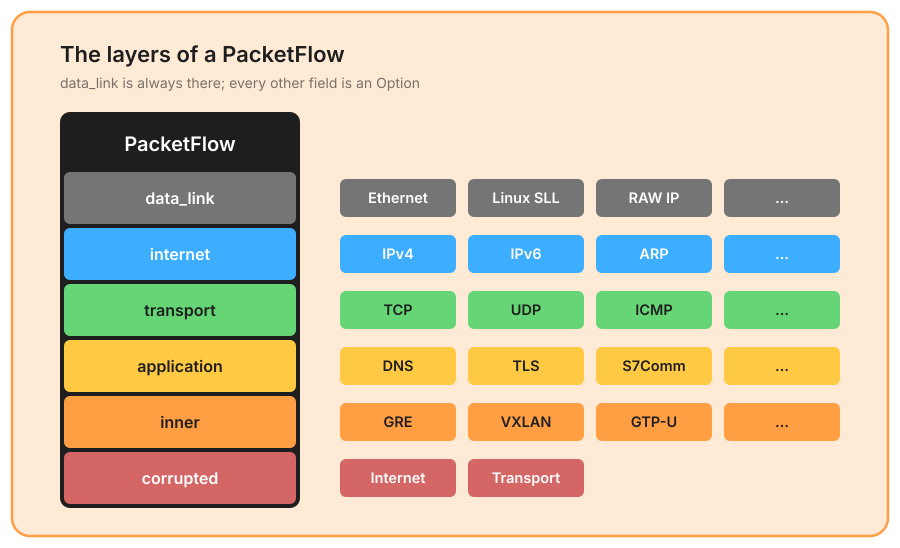
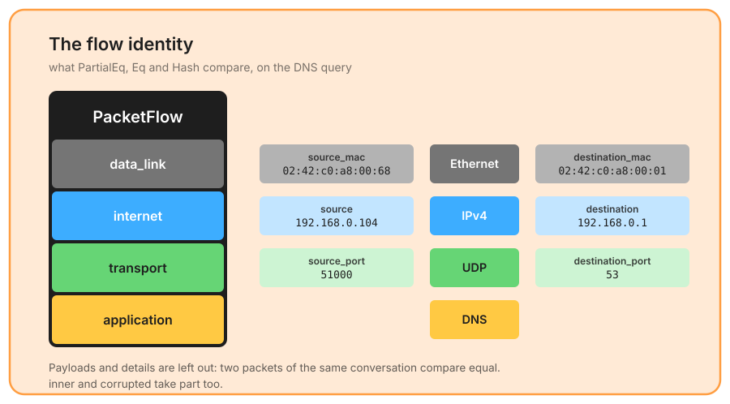
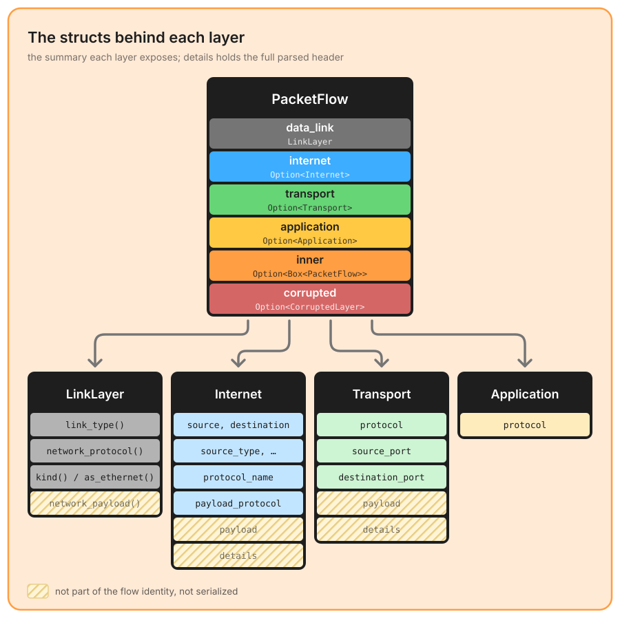
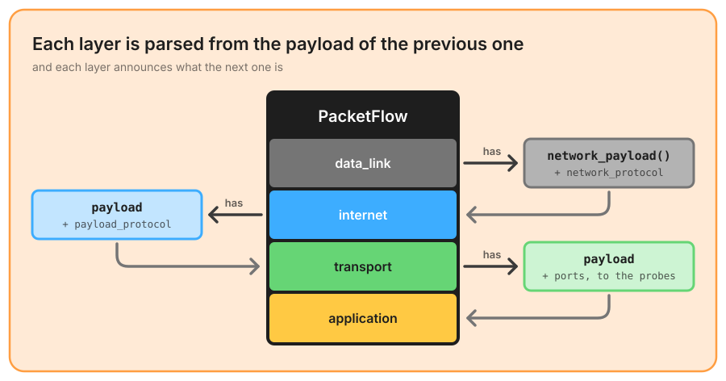

# PacketFlow struct

`parse` takes the bytes of a packet and returns a `PacketFlow`. This page shows what the bytes hold, what the struct keeps of them, and the order in which the engine fills it.

## A packet is a list of bytes



The crate receives a packet as a slice:

```rust
let packet: &[u8] = &[0x02, 0x42, 0xc0, 0xa8, 0x00, 0x01, /* 65 more bytes */];
```

The parsed structures borrow that slice and never copy it. Every one of them carries a lifetime `'a` tied to the input buffer.

## Layers in the bytes

Each protocol occupies one part of the packet:



The parts are nested. Each layer carries the next one as its payload:



## The struct

A parsed packet has four layers:



The data link layer is always present. The others depend on the packet.

```rust
pub struct PacketFlow<'a> {
    /// Link layer (mandatory), tagged with its canonical LINKTYPE.
    pub data_link: LinkLayer<'a>,
    /// Internet layer (optional).
    pub internet: Option<Internet<'a>>,
    /// Transport layer (optional).
    pub transport: Option<Transport<'a>>,
    /// Application layer (optional, best-effort).
    pub application: Option<Application>,
    /// Encapsulated packet, when this flow is a tunnel (CAPWAP, GRE, VXLAN...).
    pub inner: Option<Box<PacketFlow<'a>>>,
    /// Present when a recognized layer carried invalid bytes.
    pub corrupted: Option<CorruptedLayer>,
}
```

Two fields are not layers:

- **`inner`**. Some packets carry a whole other packet in their payload. When a tunnel is recognized, its name goes into `application` and the encapsulated packet is parsed recursively into `inner` ([Tunnels](./tunnels.md)).
- **`corrupted`**. A layer that was recognized (the EtherType said IPv4, the IP header said TCP) but whose bytes are invalid does not fail the parse. The lower layers are kept, that layer and the ones it would have carried stay `None`, and the problem is reported here ([Getting started](./getting_started.md#reading-the-outcome)).

## Flow identity

Each layer holds a source and a destination:



The flow identity is that set: MAC addresses, IP addresses, protocols, ports. `PacketFlow` implements `PartialEq`, `Eq` and `Hash` on the identity only, not on the raw bytes. Two packets of one conversation that carry different data compare equal and hash identically, which is what a flow table needs: a `HashMap<PacketFlowOwned, Stats>`. Since 11.6.0 the identity of an Ethernet frame also holds the session and the PPP protocol of a PPPoE session, which the owned form does not keep ([PPPoE session](./pppoe.md#flow-identity)).

## The structs behind each layer



Each layer exposes two levels of information:

- the flattened summary of the diagram (`source`, `destination`, `protocol_name`, `source_port`...), which is the identity of the layer and what is serialized;
- a `details` field (`InternetDetails`, `TransportDetails`) with the full parsed header (`Ipv4Packet`, `TcpPacket`, `IcmpPacket`...). The TTL, the DSCP or the TCP flags are read there, without parsing the payload again. Equality, hashing and serialization ignore `details`.

The data link layer is the exception. `LinkLayer` is format-neutral (Ethernet, RAW IP, Linux cooked capture...), and the view of one format is reached through `as_ethernet()`, `as_linux_sll()` and the like ([Data link](./data_link.md)).

## Each layer announces the next



Each layer is parsed from the payload of the one below, and each layer says what the next one is:

| Step | Input | What names the next protocol | Output |
| --- | --- | --- | --- |
| Link | LINKTYPE + packet bytes | the caller (LINKTYPE) | `LinkLayer` + `NetworkProtocol` + L3 payload |
| Internet | `NetworkProtocol` + L3 payload | EtherType / SLL protocol field | `Internet` + `payload_protocol` + L4 payload |
| Transport | `TransportProtocol` + L4 payload | IP protocol number / next header | `Transport` + ports + L7 payload |
| Application | `Transport` (ports + payload) | **content probes**, guarded by transport and sometimes by port | `Application { protocol }` |

### The engine, end to end

The table gives the principle. Here is how `parse` chains it:


Everything above `DecodedLink` depends on the capture format, and is the only part that can return `Err` ([data link chapter](./data_link.md)). Everything below it is one pipeline, shared by every LINKTYPE and by every tunnel level. It is a single function, `parse_decoded_into`, quoted here with its comments removed:

```rust
let (data_link, network_protocol, network_payload) = decoded.into_parts();
let (internet, l3_corruption) = sink.time(Stage::L3, || {
    Self::parse_l3(network_protocol, network_payload)
});
let (transport, l4_corruption) = sink.time(Stage::L4, || Self::parse_l4(internet.as_ref()));
let transport = match transport {
    Some(transport) if transport.is_anomalous_tcp() => {
        return Ok(Self::anomalous_tcp_flow(data_link, internet, transport, l3_corruption));
    }
    transport => transport,
};
let (application, inner) = sink.time(Stage::L7, || {
    let (application, inner) =
        Self::parse_l7_and_inner(internet.as_ref(), transport.as_ref(), depth, decode_as);
    (application.or_else(|| Self::detect_stp(&data_link)), inner)
});
Ok(PacketFlow {
    data_link, internet, transport, application, inner,
    corrupted: l3_corruption.or(l4_corruption),
})
```

Read from top to bottom:

- **Each stage turns its error into data.** `parse_l3` and `parse_l4` map `UnsupportedProtocol` to `None` and every other error to a `CorruptedLayer`. Since 13.0.0 its `error` is the error itself, typed, `CorruptedLayerError::Internet` or `CorruptedLayerError::Transport`; until 12.x it was the error's `Display`, a `String` ([#275](https://github.com/Akmot9/Packet-parser/issues/275)). Building it no longer allocates: an IPv4 total length past the frame costs 106 ns instead of 365, about the cost of a sound ACK. A layer that is `None` leaves nothing for the next one, so `corrupted` holds at most one report: `l3_corruption.or(l4_corruption)` is the first failure, and the only one.
- **An anomalous TCP segment leaves before L7**, in a `#[cold]` function: transport kept, anomaly reported, no application. Weaving that case into the common stages cost about 10 ns on every TCP segment ([transport chapter](./tcp.md)).
- **L7 has a fixed order.** First an IP-level tunnel (GRE, IP-in-IP), then a UDP tunnel (CAPWAP, VXLAN, Geneve, GTP-U), then the [dispatch table](./application.md), Decode As ports first. STP comes last, from the link layer, and only when nothing gave a label: a BPDU has no network layer to reach the table.
- **A tunnel re-enters at `DecodedLink`**, one level deeper, with the same Decode As ports ([tunnels chapter](./tunnels.md)). That recursion runs inside the L7 stage, which is where its time is counted.
- **`sink` is the timing**: a no-op for `parse`, a clock for `parse_timed`, so the measured path is the parsed path ([getting started](./getting_started.md#timing-benchmarks)).

## The port never decides alone

Up to the transport layer, a field names the next protocol: the EtherType, then the IP protocol number. Above it, nothing does. A port number is a convention, which a scanner, a relay or an administrator can break, so port 80 does not make a payload HTTP.

The application label therefore comes from the content. Where the content is enough, a rule of the dispatch reads it on any port. Where it is not, the port is added as a guard: an FTP reply, an SMTP reply and an NNTP reply are the same bytes (`220 text CRLF`), and each is labelled only on its own port. In both cases the content must match. The [Application](./application.md) chapter has the table of these rules.
