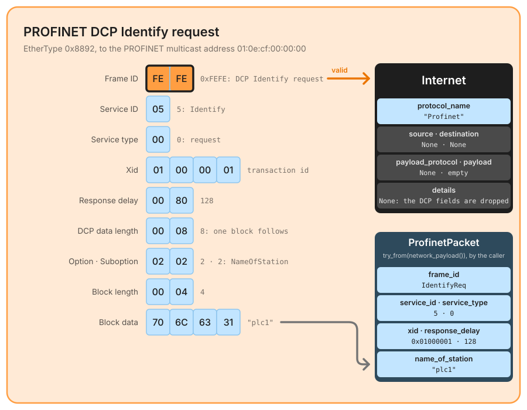
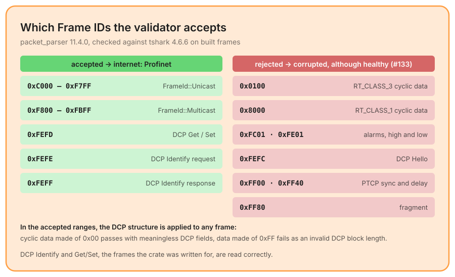

# Profinet

Announced by EtherType `0x8892`, and checked by the [internet layer](./network.md). PROFINET is the industrial Ethernet of Siemens and the PROFIBUS & PROFINET International group (IEC 61158): cyclic I/O data, alarms, clock synchronization and a discovery protocol, **DCP**, all carried directly in Ethernet frames, without IP. The crate recognizes the EtherType and validates the frame as DCP; it decodes nothing into the flow.

## What the internet layer keeps



A PROFINET frame has no network addresses, and the crate gives it none: the `Internet` built by the private `Internet::profinet()` has `protocol_name: "Profinet"`, `source` and `destination` `None`, no `payload_protocol`, an empty `payload` and `details: None`. Nothing is parsed above it. The flow identity of a PROFINET frame is therefore its data link layer: for the Identify request drawn here, the station's MAC address and the PROFINET multicast address `01:0e:cf:00:00:00`, which `display_with_oui()` prints as `PnMc:00:00:00`, the one multicast prefix of the crate's [OUI table](./ethernet.md).

The validation is `ProfinetPacket::try_from`, and its result is discarded. A caller who wants the DCP fields runs it again on the link payload:

```rust
use packet_parser::parse::internet::protocols::profinet::ProfinetPacket;

if flow.data_link.network_protocol() == NetworkProtocol::Profinet
    && let Ok(dcp) = ProfinetPacket::try_from(flow.data_link.network_payload())
{
    println!("{:?} service {} xid {:#010x} station {:?}",
        dcp.frame_id, dcp.service_id, dcp.xid, dcp.name_of_station);
}
```

On the frame above this prints `IdentifyReq service 5 xid 0x01000001 station "plc1"`. `ProfinetPacket` keeps the DCP header (`frame_id` as a `FrameId`, `service_id`, `service_type`, `xid`, `response_delay`, `dcp_data_length`) and the **first block only** (`option`, `suboption`, `dcp_block_length`, and its data as `name_of_station`).

## The DCP validation

✅ **Minimum length** – at least **16 bytes**, otherwise `ProfinetPacketError::PacketTooShort`.  
✅ **Frame ID** – one of the values `FrameId` names: `0xC000..=0xF7FF` (`Unicast`), `0xF800..=0xFBFF` (`Multicast`), `0xFEFD` (Get/Set), `0xFEFE` (Identify request), `0xFEFF` (Identify response), otherwise `UnknownFrameId`.  
✅ **First block** – its header is at offset 12, and its declared length fits in the buffer, otherwise `InvalidDcpBlockLength`.  
✅ **Block data** – valid UTF-8, read as the NameOfStation, otherwise `InvalidNameOfStation`.  

A failure is reported in `corrupted` (`layer: Internet`), since the EtherType said PROFINET: `Profinet error: Unknown Frame ID: 0xfefc`. Bytes past the first block, the Ethernet padding included, are ignored.

## What it rejects, and should not

The validator is a DCP parser applied to every PROFINET frame, and `FrameId` names only part of the Frame ID space. The consequence is drawn below, checked against tshark on built frames ([#133](https://github.com/Akmot9/Packet-parser/issues/133)). This is the 11.5.0 behaviour: the fix is merged on the crate's `main` ([#142](https://github.com/Akmot9/Packet-parser/pull/142)) and ships with the next release, and this page will follow it:



Two effects follow, both on healthy traffic:

- a frame whose Frame ID is outside the accepted set is `corrupted` with `UnknownFrameId`: the cyclic I/O data that makes up most of a PROFINET capture (RT_CLASS_1 at `0x8000`, RT_CLASS_3 at `0x0100`), the alarms, a DCP Hello (`0xFEFC`), PTCP, fragments;
- a cyclic frame *inside* the accepted ranges is read as DCP: its data bytes land in the block header, so a frame of zeros passes with meaningless fields, and a frame of `0xFF` fails with a message that contradicts itself, `Invalid DCP block length: expected at least 4 bytes, found 34 bytes`, the variant being reused for a declared length that overflows the buffer.

The fix proposed in the issue is to validate at this level only what every PROFINET RT frame shares, the Frame ID and its assigned range, and to apply the DCP decoder to DCP Frame IDs only. Until then, a consumer that meets PROFINET should treat `corrupted: Internet` with `Unknown Frame ID` as "PROFINET, not DCP" rather than as a bad frame. The repository holds no PROFINET capture, which is how the defect stayed invisible.

## What is left out

- **Only DCP, and only its first block.** A request with several blocks, or a response, where each block carries two bytes of BlockInfo before its data, is read as one block: on an Identify response the name comes out as `"\0\0plc1"`, BlockInfo included.
- **No cyclic data, alarms or PTCP**: PROFINET IO itself is not decoded, and the crate has no `details` for it.
- **PROFINET over UDP** (RT_CLASS_UDP, ports 34962 to 34964) is ordinary UDP to the crate: no rule of the dispatch table names it.
