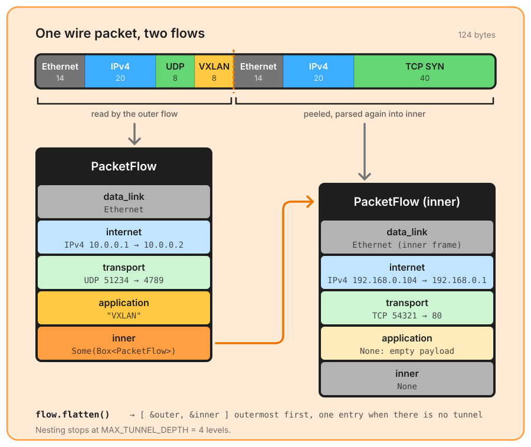

# Tunnels

Some packets carry a **whole other packet** inside their payload. The base pipeline is layered and single-level: without help it only sees the *outer* flow (say, UDP between two data centres) and misses the real conversation nested inside.

## `inner` and `flatten()`

When a tunnel is recognized, its name goes into the outer flow's `Application::protocol`, its headers are peeled, and the encapsulated packet is fed back into the **same** L3/L4/L7 pipeline, recursively, into `inner`:

```rust
pub struct PacketFlow<'a> {
    // ...
    pub inner: Option<Box<PacketFlow<'a>>>,
}
```

One wire packet then yields several flow levels, outermost first:

```rust
let flow = parse(LinkType::ETHERNET, &packet)?;

for level in flow.flatten() {
    println!("{:?} -> {:?}", level.internet, level.transport);
}
```

Here is the TCP SYN of the previous chapters, carried in a VXLAN tunnel between two hypervisors:



The outer flow stops at the VXLAN header: its `application` is the tunnel's name, and the 74 bytes that follow, a complete Ethernet frame, are parsed again from the link layer up into `inner`. `flatten()` returns the two levels, outer first.

A non-tunneled packet yields one entry. The inner flows borrow the same buffer as the outer one: peeling is zero-copy, only the recursion boxes.

Nesting is bounded by `MAX_TUNNEL_DEPTH = 4`, an anti-loop guard against malformed traffic that could claim endless encapsulation. The bound counts flow levels, the outer one included: `flatten()` returns at most four entries. At the fourth level the tunnel is no longer peeled, and its payload goes to the dispatch table like any other: four VXLAN layers around the SYN above give three flows labelled `"VXLAN"`, then a fourth labelled `"Unknown"`, and the SYN is never read.

## Supported tunnels

| Tunnel | Detected from | Inner |
| --- | --- | --- |
| CAPWAP-Data (RFC 5415) | UDP/5247 | IEEE 802.11 → LLC/SNAP → L3 |
| GRE v0 (RFC 2784/2890) | IP protocol 47 | IPv4, IPv6 or Ethernet (0x6558) |
| IP-in-IP | IP protocols 4 and 41 | bare IPv4 / IPv6 |
| VXLAN (RFC 7348) | UDP/4789 | full Ethernet frame |
| Geneve (RFC 8926) | UDP/6081 | Ethernet (0x6558) or bare IP, options skipped |
| GTP-U (3GPP TS 29.281) | UDP/2152 | bare IP, no L2 |

### CAPWAP without an inner flow

Only a CAPWAP data frame, an IEEE 802.11 data frame on UDP 5247, carries a conversation to peel. Until 13.3.0 everything else on the two CAPWAP ports was `"Unknown"`: the control channel on UDP 5246, in clear or under DTLS, the keep-alives of the data channel, fragments, and 802.11 management frames. Since 13.3.0 ([#355](https://github.com/Akmot9/Packet-parser/issues/355), PR [#360](https://github.com/Akmot9/Packet-parser/pull/360)) they are labelled `"CAPWAP"`, with no `inner`.

The label comes from rule 74 of the [dispatch table](./application.md#reading-the-table), a port rule on UDP 5246 and 5247. Its probe accepts two shapes:

- **a CAPWAP header** (RFC 5415 §4.3): version 0, a header length of at least two words that fits in the datagram, a wireless binding identifier that is not zero, reserved bits that are null, and neither the last-fragment bit nor a fragment offset without the fragment bit;
- **the DTLS preamble**, followed by a DTLS 1.0 or 1.2 record. What the record carries is encrypted, and is not read.

The rule sits in the blind cascade, after every UDP probe that has a signature. 5246 and 5247 are above 1023, and any client may draw them as its source port: a DNS answer or a QUIC packet that lands there keeps its own label. The same datagram on another port is `"Unknown"`: the header alone is too loose to run blind.

The golden test `tests/capwap_golden.rs` compares the crate with tshark 4.6.9 on 341 datagrams of four captures already in the corpus (`tools/capwap_oracle.sh`, frozen in `tests/data/capwap_tshark_oracle.tsv`): 34 control messages in clear, 284 under DTLS, 12 keep-alives and 11 management frames. The crate and tshark name the same datagrams, and none of them has an `inner`.

## Encrypted encapsulations

The encrypted encapsulations get a label but no `inner`: OpenVPN, [WireGuard](./wireguard.md) and [ESP](./esp.md) in UDP 4500 carry ciphertext, and native ESP, IP protocol 50, is a transport layer without a payload. A [PPPoE session](./pppoe.md) is not a tunnel either: the link layer peels it like a VLAN tag, and the IP packet it carries is the flow itself.

## Two detection points

Tunnels are looked for at two places in the pipeline, because they live at two levels:

- **IP-level** (`detect_inner_l3`), from `Internet::payload_protocol`, first in the L7 stage, before the transport-level detection and the application probes. Transport parsing has already run by then, but GRE and IP-in-IP have no transport layer, so their detection does not depend on the hollow `Transport` the catch-all branch of `try_from_parts` builds for them. A fragmented packet has no `payload_protocol`, so a tunnel carried in fragments is not peeled. For IP-in-IP, the outer protocol number *announces* the inner version (4 or 41), and the raw-IP decoder checks it against the inner version nibble: a mismatch is refused.
- **Transport-level** (`detect_inner`), from a UDP port and the payload shape: CAPWAP, VXLAN, Geneve, GTP-U.

Detection returns `None`, never an error: no tunnel, an encrypted payload (CAPWAP over DTLS), a truncated one, or a shape the crate does not decode all mean "this is just an ordinary flow". The flow then goes to the dispatch table, which may still name it: that is how a CAPWAP datagram without a conversation to peel [gets its label](#capwap-without-an-inner-flow).

## Refuse, don't guess

Every tunnel decoder rejects the variants it cannot attest instead of guessing a shape: GRE version 1 (PPTP), ERSPAN and routing bits; VXLAN GBP/GPE flag extensions; Geneve OAM control messages; GTPv0, GTP' (a billing protocol on the same port) and every GTP-U message type other than G-PDU (echo requests and the whole control plane carry no user packet).

GTP-U is special in one way: alone among these, its header says **nothing** about what it carries (VXLAN is always Ethernet, Geneve announces an EtherType). So it is the only tunnel whose label requires the inner packet to parse cleanly first.

A fragmented outer datagram is never peeled: reassembly is stateful, and a tunnel must not be reported as more complete than the datagram carrying it.

## The inner link layer is honest

The inner packet enters the pipeline through the same `DecodedLink` as a top-level packet: VXLAN produces an `Ethernet` link layer; GRE and Geneve an `Ethernet` one when they announce `0x6558`, a `RawIp` one for bare IP; IP-in-IP and GTP-U a `RawIp` one; and CAPWAP an `Ieee80211Link` with the real 802.11 addresses and the SNAP protocol. Nothing fabricates an Ethernet header for a tunnel that does not carry one, which is the same principle as the [data link chapter](./data_link.md).

The "Decode As" configuration is propagated into the inner flows, so a declared port works inside a tunnel too.
