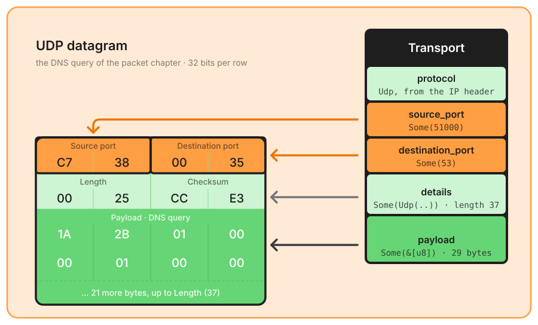
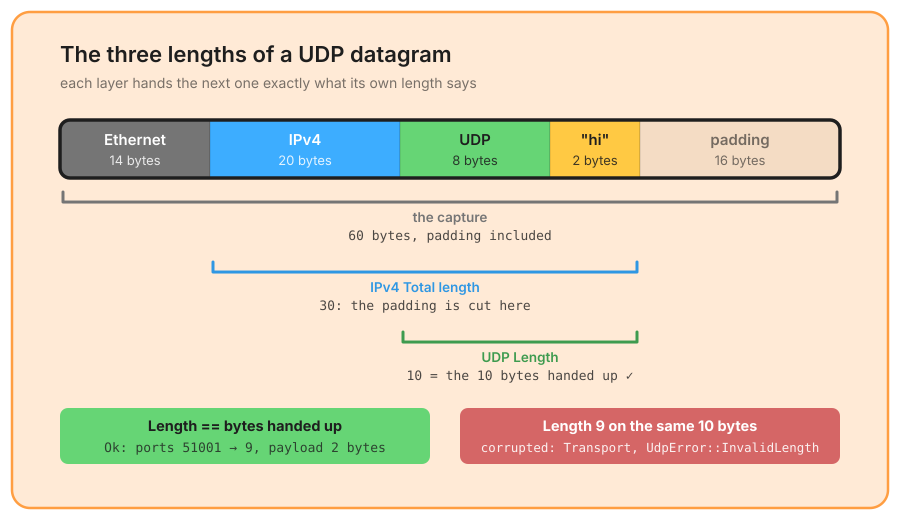

# UDP

IP protocol 17, parsed by the [transport layer](./transport.md). UDP (RFC 768) is the smallest transport header there is: two ports, a length and a checksum, eight bytes, and the datagram is the message. Most of what the crate labels above the transport layer travels in it: DNS, NTP, SNMP, DHCP, QUIC, and the tunnels.

## The datagram

This is the datagram of the DNS query drawn in the [packet chapter](./packet.md). As for TCP, the ports are in orange: they are the hint the [application table](./application.md) starts from, never the verdict. `UdpPacket` keeps `source_port`, `destination_port`, `length`, `checksum` and `payload`, and is reached through `details` (`TransportDetails::Udp`); `Transport` gets its `protocol` from the IP header, not from these bytes.

## Validations

✅ **Minimum length** – at least **8 bytes**, otherwise `UdpError::PacketTooShort { expected, actual }`.  
✅ **Length field** – **equal** to the number of bytes handed up, otherwise `UdpError::InvalidLength { length, actual }`.  

`payload` is everything after the 8-byte header. UDP has no semantic anomaly: a datagram either parses or corrupts the layer, reported as `corrupted: Transport` with the error's text, for instance `UDP error: UDP length field (9) doesn't match actual packet length (10)`.

### Why an exact length

UDP is the one header whose declared length must match the buffer *exactly*, where IPv4 accepts a longer buffer. The reason is the layer below:

Ethernet pads short frames to 60 bytes, so a small datagram arrives with trailing zeros that are not its own. The [internet layer](./ipv4.md) already cuts them: it hands the transport layer `data[header_len..total_length]` for IPv4, `40 + payload_length` bytes for IPv6, never the padding. What UDP receives is therefore exactly what IP said it carried, and a `Length` that disagrees with it is not a padded datagram, it is a lie about the message: a longer `Length` would read past the datagram into whatever follows, a shorter one would hide bytes at the end. Both are refused.

A fragmented IP datagram never reaches this parser: `payload_protocol` is `None` for it and the transport layer is skipped ([IPv4 fragments](./ipv4.md#fragments)), precisely because a UDP `Length` covers the whole datagram and the first fragment alone would fail this check while being healthy.

## Above the datagram

The ports and the payload go to the [application stage](./application.md). Two things happen before the dispatch table:

- **UDP tunnels** are looked for first, by port and shape: CAPWAP on 5247, VXLAN on 4789, Geneve on 6081, GTP-U on 2152. A match makes the tunnel's name the flow's `application_protocol` and parses the carried packet into `inner` ([tunnels](./tunnels.md)).
- **Declared ports** (`ParseConfig::decode_as`) are tried next, then the table's rules, those with `Guard::Udp` or `Guard::Any`: a rule the RFC reserves to TCP never runs on a datagram.

An empty payload (a datagram of exactly 8 bytes) is not probed, and `application` stays `None`.

## Checksum

The checksum is read into `details` and never verified during parsing: on a sender-side capture with hardware offloading it is uncomputed, and refusing those datagrams would reject healthy traffic. `packet_parser::checksum::verify_udp_checksum(source, destination, datagram)` is the opt-in check; it needs the IP addresses for the pseudo-header, and returns `None` rather than a verdict when the field is `0`, the "not computed" value RFC 768 allows over IPv4 (over IPv6 the checksum is mandatory, and the function makes no difference: `0` is `None` there too).

## What is left out

- **UDP-Lite** (IP protocol 136) is another protocol number: the flow gets `TransportProtocol::Udplite` as its name, without ports or payload.
- **No reassembly**, as everywhere in the crate: a datagram split by IP fragmentation has no transport layer.
- **The checksum is not a validation**: a wrong checksum parses like a right one; see above.
